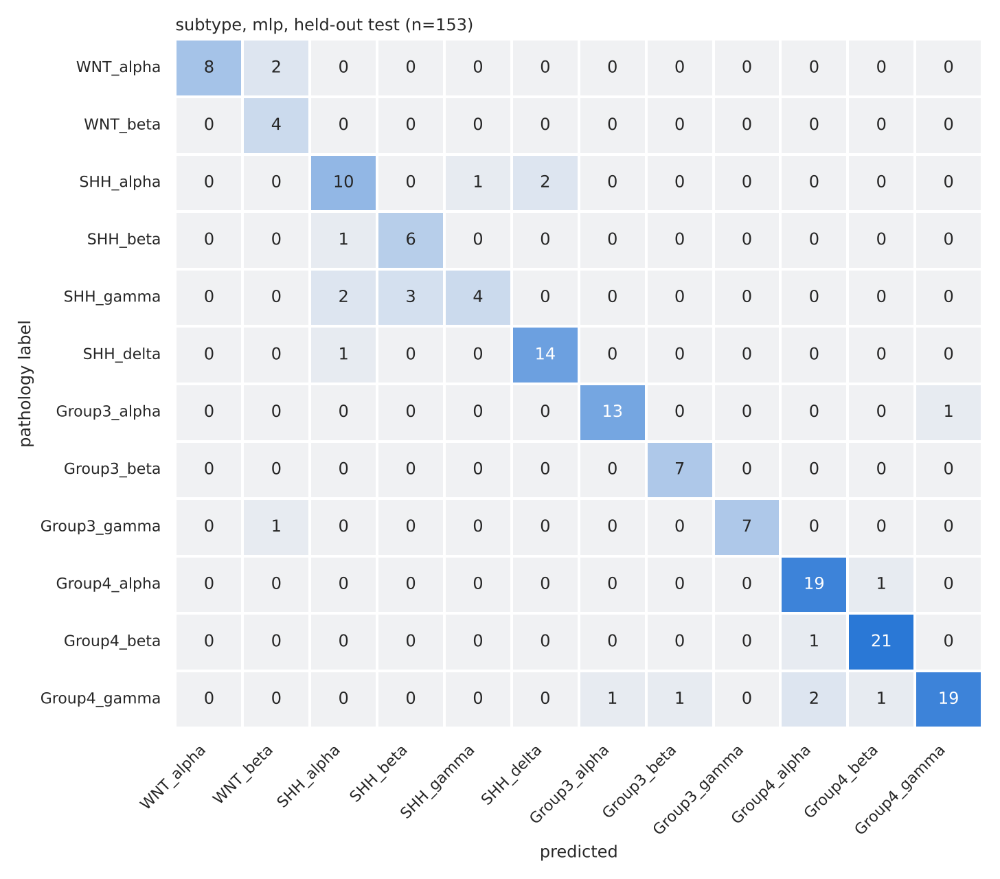
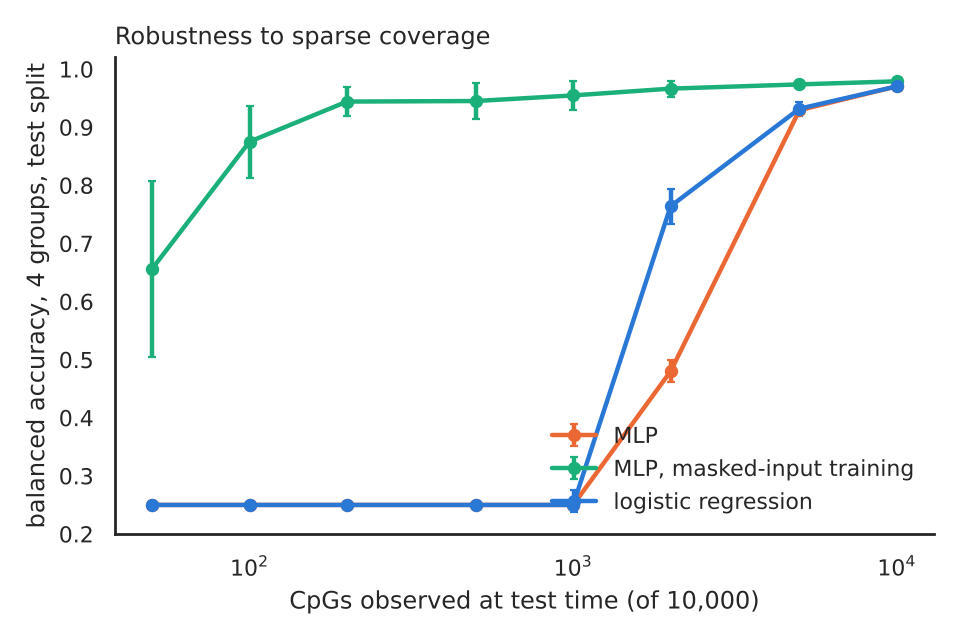
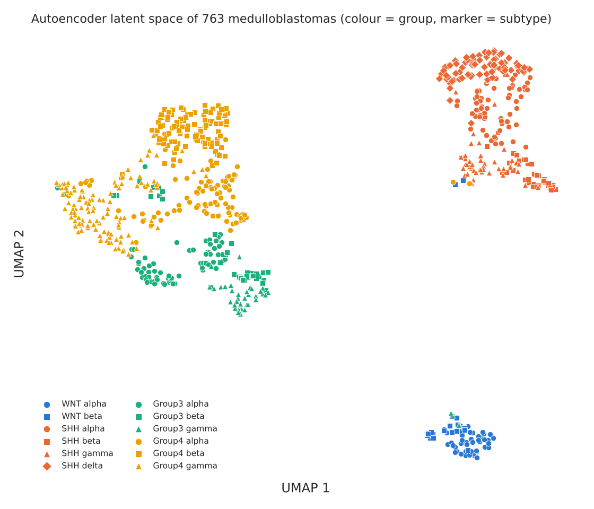
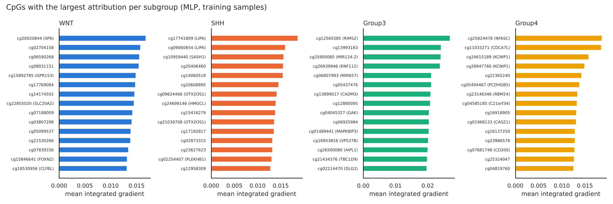
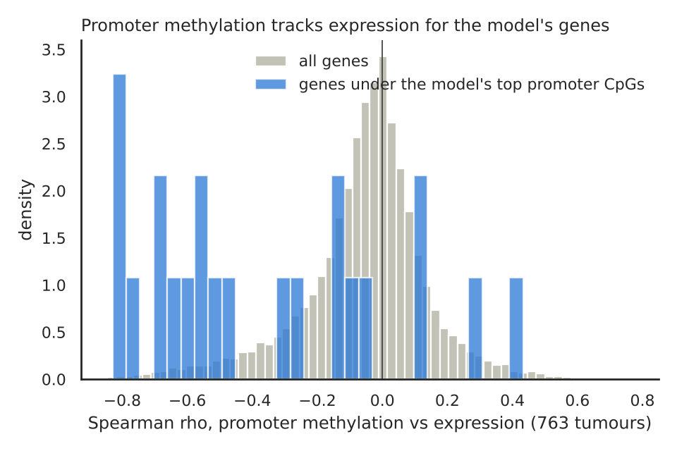
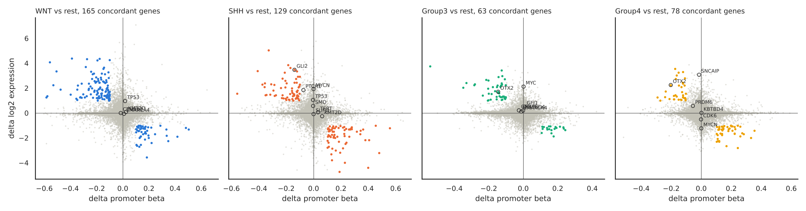
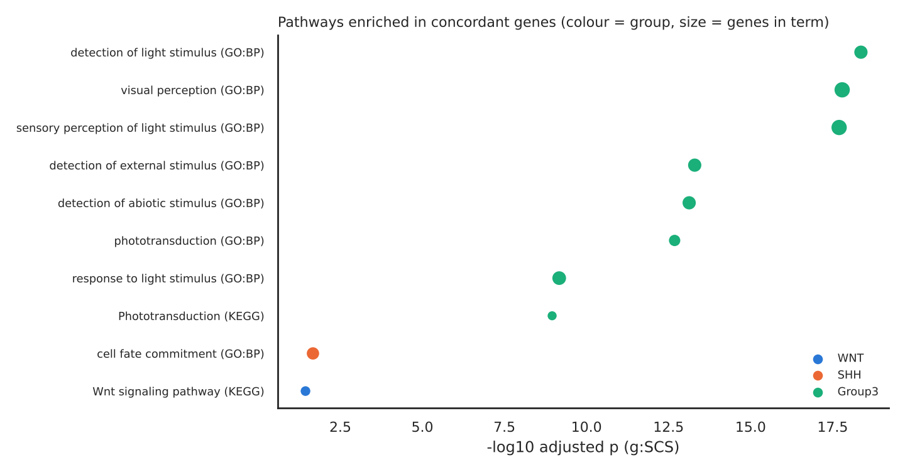

# Medulloblastoma subgroups from DNA methylation, with explanations

A small, fully reproducible project on public data. It trains classifiers that
assign medulloblastoma tumours to their molecular subgroup (WNT, SHH, Group 3,
Group 4) and subtype (12 classes) from Illumina 450k methylation arrays, explains
which CpG sites drive each call, and checks those explanations against gene
expression measured in the same tumours, against pathways, and against known
driver genes.

This is a first, self-taught methylation project. Everything here was built from
public GEO files in a few days. It is not a diagnostic tool and makes no claim
beyond what the code reproduces.

## Read the analysis

Nine pages, each an executed notebook, in reading order. The links open the rendered pages;
the same files are in `docs/` and the notebooks in `notebooks/`.

1. [The question and the data](https://robinson-vidva.github.io/mb-methylation-xai/01_question_and_data.html)
2. [Quality control](https://robinson-vidva.github.io/mb-methylation-xai/02_quality_control.html)
3. [Classification](https://robinson-vidva.github.io/mb-methylation-xai/03_classification.html)
4. [Explainability](https://robinson-vidva.github.io/mb-methylation-xai/04_explainability.html)
5. [Methylation versus expression](https://robinson-vidva.github.io/mb-methylation-xai/05_methylation_vs_expression.html)
6. [Pathways and therapy](https://robinson-vidva.github.io/mb-methylation-xai/06_pathways_and_therapy.html)
7. [Gene clusters and pathway flow](https://robinson-vidva.github.io/mb-methylation-xai/07_gene_clusters_and_pathway_flow.html)
8. [Genes: names, cancer roles and literature](https://robinson-vidva.github.io/mb-methylation-xai/08_genes_roles_and_literature.html)
9. [Conclusions](https://robinson-vidva.github.io/mb-methylation-xai/09_conclusions.html)

## Data

| Source | Content | Role |
|---|---|---|
| GSE85212, Cavalli et al. 2017 | 763 primary medulloblastomas, 450k beta values | training and held-out test |
| GSE85217, Cavalli et al. 2017 | the same 763 tumours, Affymetrix expression | methylation versus expression |
| GSE54880, Hovestadt et al. 2013 | 276 medulloblastomas, 450k, 169 FFPE and 107 frozen | external test cohort |
| GPL13534 manifest | Illumina 450k probe annotation | CpG to gene mapping |

Labels are the published subgroup and subtype calls deposited with the data.
All files are public and downloaded by `scripts/01_download.py`, checksums included.

## Pipeline

```
scripts/01_download.py    fetch GEO files, verify md5
scripts/02_preprocess.py  filter probes, stratified split, top 10,000 variable CpGs (training set only),
                          promoter and gene body methylation per gene, expression matrix, external cohort
scripts/00_qc.py          probe funnel, beta distributions, failed probes and sex check in the external
                          cohort, PCA
scripts/03_train.py       logistic regression, random forest, PyTorch MLP; cross-validation, test split,
                          calibration, external validation, sparse-coverage simulation
scripts/04_explain.py     integrated gradients per subgroup, CpG to gene, autoencoder latent space, UMAP
scripts/05_integrate.py   methylation versus expression, differential analysis, g:Profiler enrichment,
                          driver gene overlap
scripts/06_therapy.py     Open Targets lookup: drugs, tractability and medulloblastoma association for
                          every concordant gene and driver gene
scripts/07_networks.py    gene clusters, co-methylation network, KEGG pathway flow for Hedgehog, Wnt and
                          the photoreceptor program, pathway activity per tumour
scripts/08_gene_annotation.py  gene names, oncogene and tumour suppressor status (OncoKB, COSMIC), Reactome
                          pathways, PubMed counts in medulloblastoma, and the reading of each methylation
                          change against the gene's role
scripts/make_report.py    writes the nine report notebooks; run_all.sh executes them and exports
                          them to docs/ as HTML
```

Run everything with `./run_all.sh` after `conda env create -f environment.yml`
(or `pip install -r requirements.txt` in a Python 3.13 virtual environment).
The raw download is about 2.7 GB; preprocessing needs about 6 GB of memory. No GPU is needed.
The executed notebooks are exported to `docs/` as self-contained HTML pages, readable without Python.

Preprocessing choices: autosomal cg probes only, probes with a known SNP removed, probes with
any missing value removed, 308,020 CpGs retained. The split is 610 training and 153 test
tumours, stratified by subtype. Feature selection uses training-set variance only. The
external cohort is masked at detection p above 0.01 and imputed with training medians.

## Results

### Classification

Cross-validation on the training split, mean of 5 folds, and one evaluation on the held-out
test split. Full tables in `results/tables/`.

| Task | Model | CV balanced accuracy | Test balanced accuracy | Test macro F1 |
|---|---|---|---|---|
| 4 groups | logistic regression | 0.978 | 0.970 | 0.968 |
| 4 groups | random forest | 0.978 | 0.974 | 0.974 |
| 4 groups | MLP | 0.977 | 0.970 | 0.968 |
| 12 subtypes | logistic regression | 0.903 | 0.810 | 0.817 |
| 12 subtypes | random forest | 0.871 | 0.859 | 0.867 |
| 12 subtypes | MLP | 0.882 | 0.859 | 0.840 |

The 4-group task is close to solved by any model, which matches the literature. The
subtype task is where the errors are, almost all of them inside the SHH and WNT groups:
SHH gamma versus SHH alpha and beta, and WNT beta, which has only 4 test tumours.



### External cohort

Models trained on Cavalli only, applied to the 276 Hovestadt tumours from a different
laboratory, with the 4-group labels.

| Model | All (n=276) | Frozen (n=107) | FFPE (n=169) |
|---|---|---|---|
| logistic regression | 0.979 | 0.967 | 0.988 |
| random forest | 0.976 | 0.967 | 0.982 |
| MLP | 0.983 | 0.975 | 0.988 |

Balanced accuracy. Formalin-fixed material classifies as well as frozen material.

### Calibration

Expected calibration error of the MLP on the test split is 0.023 for the 4-group task
and 0.103 for the 12-subtype task. For the 4 groups, 99 percent of predictions carry a
confidence above 0.9 and are almost always right. For the 12 subtypes, 90 percent of
predictions still carry a confidence above 0.9 while only 86 percent are right, so the
subtype model is overconfident and would need temperature scaling or similar before
anyone trusted its scores. Figure: `results/figures/calibration_mlp.png`.

### Sparse coverage

Shallow nanopore sequencing yields a random, sparse subset of CpGs. The simulation removes
CpGs at random at test time and measures 4-group balanced accuracy over 10 repeats.



A model trained on complete arrays degrades at half coverage and collapses to chance
once fewer than a fifth of the CpGs are seen.
The same MLP trained with random input masking keeps balanced accuracy above 0.94 with
200 of 10,000 CpGs, and 0.87 with 100. The idea is simple and the effect is large.

### Representation learning

A 16-dimensional autoencoder trained on the training split. A linear classifier on the
latent space reaches 0.975 cross-validated balanced accuracy for the 4 groups against
0.978 on the raw 10,000 CpGs, and 0.836 against 0.903 for the 12 subtypes. The latent
space separates the groups cleanly and shows the subtypes as sub-clusters.



### Explainability

Integrated gradients on the MLP, baseline the mean training profile, averaged over the
correctly classified training tumours of each group. Top 50 CpGs per group with gene,
region and direction in `results/tables/top_cpgs_per_group.csv`.



### Do the explanations mean anything biologically?

This is the part the matched expression data makes possible.

1. **Promoter methylation versus expression, same tumours.** Across all 15,333 genes with
   both measurements, the median Spearman correlation between promoter methylation and
   expression is close to zero (-0.03) and only 10 percent of genes fall below -0.3. For
   the 22 genes under the model's top promoter CpGs the median is -0.49 and 59 percent
   fall below -0.3. The CpGs the model relies on are, disproportionately, sites where
   methylation actually tracks expression. Examples: VRK2 (rho -0.83, WNT), RBM24
   (-0.82, Group 4), POU2F1 (-0.79, Group 4), AIPL1 (-0.63, Group 3).

   

2. **Concordant genes per group.** Genes whose promoter methylation and expression both
   change, in opposite directions, in one group versus the rest (FDR below 0.05, delta
   beta above 0.10, log2 fold change above 1): WNT 165, SHH 129, Group 4 78, Group 3 63.

   

3. **Pathways.** g:Profiler on the concordant genes with the 15,333 tested genes as
   background. Group 3 is dominated by a photoreceptor program: detection of light
   stimulus, visual perception, phototransduction, with NRL, RCVRN, AIPL1, GNAT1 and
   IMPG2 among the genes. A photoreceptor program driven by NRL and CRX is a known
   feature of Group 3 medulloblastoma (Garancher et al. 2018), and the analysis recovers
   it without being told. WNT returns the KEGG Wnt signalling pathway.
   SHH returns cell fate commitment. Group 4 returns no significant term.

   

4. **Known driver genes.** A short curated list from Northcott et al. 2017 and Cavalli et
   al. 2017, checked against the array data. This is literature overlap only: the cohort
   has no per-patient mutation calls, so nothing here tests mutation status.
   None of the driver genes appears among the model's top 50 CpGs, which is expected:
   drivers are defined by mutation or structural events, not by their own promoter
   methylation. Three drivers are concordant in their group: GLI2 in SHH (promoter
   hypomethylated, expression up 3.5 log2 units, rho -0.51) and OTX2 in both Group 3
   and Group 4 (rho -0.72). PTCH1, SMO, MYCN and TP53 are strongly over-expressed in
   SHH, MYC in Group 3 and SNCAIP in Group 4, each with no or minimal promoter
   methylation change. X-linked drivers (DDX3X, KDM6A, ZMYM3) are absent because sex
   chromosome probes were excluded. Table: `results/tables/driver_gene_overlap.csv`.

5. **Drugs.** Every concordant gene and every driver gene was looked up in the Open Targets
   Platform for approved drugs, clinical compounds and tractability. Most concordant genes have no
   drug. Those that do are mostly ion channels, phosphodiesterases and stromal genes with drugs made
   for other diseases; leads include SYK and EPHA3 (on in WNT), IGF1 (on in Group 3), FZD7, FAP and
   MAPK10 (on in SHH). The approved subgroup-specific drugs act on drivers whose promoters do not
   change: SMO (vismodegib, sonidegib) in SHH and CDK6 in Group 4. Table:
   `results/tables/therapy_candidates.csv`. This is hypothesis generation, not a treatment claim.

6. **Pathway flow.** Concordant genes cluster into subgroup blocks and form a co-methylation
   network with one community per lineage. Placing the Hedgehog, Wnt and photoreceptor pathways in
   signalling order shows two modes of activation. In SHH and WNT tumours the pathway targets (PTCH1,
   GLI1, MYCN; AXIN2, LEF1, NKD1) are strongly over-expressed with flat promoter methylation, the mark
   of activation by mutation. In Group 3 the photoreceptor program is hypomethylated and expressed at
   every level, from OTX2, NRL and NR2E3 to GNAT1, SAG and AIPL1, the mark of activation by
   demethylation. Figures: `results/figures/pathway_flow.png`, `results/figures/pathway_activity.png`.

7. **Gene roles and literature.** Every gene in the analysis was annotated with its full name,
   oncogene or tumour suppressor status (OncoKB and the COSMIC Cancer Gene Census), Reactome
   pathways and a PubMed count with medulloblastoma. Of 464 genes, 46 carry a cancer role, and
   262 of the 325 concordant genes have never been mentioned with medulloblastoma: the methylation
   signature is made of lineage genes. The one informative exception is WNT, where the tumour
   suppressors RNF43, ZNRF3 and APCDD1 are switched on together with AXIN2, NKD1 and NOTUM. They are
   the negative feedback targets of beta-catenin, induced but powerless against a CTNNB1 mutation
   downstream of them, while the Wnt antagonist SFRP1 is silenced by hypermethylation. IGF1 is the
   one oncogene switched on in Group 3. Tables: `results/tables/gene_annotation.csv`,
   `results/tables/gene_regulation_concordant.csv`.

### Related work

A published R package, MBMethPred (Sharif Rahmani et al. 2023, Frontiers in Genetics,
https://doi.org/10.3389/fgene.2023.1233657), classifies the four subgroups from the same GSE85212
cohort. It is cited as prior work. The subtype task, the gene-by-gene test against expression,
calibration, sparse coverage and the drug lookup are not part of it. Tuerxun et al. 2026 integrated
the same two GEO series for a prognostic model (https://doi.org/10.1177/20503121251386139); survival
is not analysed here.

### Literature check

Three observations were checked against PubMed (page 9 has the detail). The demethylation-driven
Group 3 photoreceptor program is consistent with enhancer-level findings (Hovestadt et al. 2014,
Chen et al. 2025) and with the tumour-associated photoreceptor signature of Gudenas et al. 2026;
the side-by-side contrast with the mutation-driven Hedgehog and Wnt targets, at promoter level in the
same tumours, was not found in the searched literature. The known SHH hypomethylation of VAV1
(Lindsey et al. 2014) is present in the data. ZNRF3 over-expression as a WNT marker is known
(Vriend et al. 2019, 2020); the promoter hypomethylation of RNF43, ZNRF3, APCDD1 and SP5 in WNT
tumours was not found. None of this is a novelty claim; an independent cohort would be the next step.

## Reproducibility

The numbers above come from the run that produced `results/`, on Linux (x86_64, PyTorch CPU
wheel). The pipeline was rerun from the same code, seeds and GEO files on a second machine
(Windows 11, AMD Ryzen 5 5500U, PyTorch 2.14.1 CPU wheel, MKL and oneDNN) and the tables from that
run are in `results_windows/tables/`. The QC tables (`qc_*`), the Open Targets tables (`therapy_*`) and the cluster, network and
pathway tables (`gene_clusters*`, `network_*`, `pathway_*`) and the gene annotation tables (`gene_annotation*`,
`gene_regulation_*`, `gene_literature_*`) in `results/` were computed on the Windows machine; they depend only on deterministic steps and on
the concordant gene list, which was identical on both machines. Everything computed by scikit-learn, scipy and statsmodels
reproduced exactly: preprocessing, logistic regression and random forest cross-validation,
the differential analysis, the concordant genes, the pathway enrichment and the driver gene
table. Everything that passes through PyTorch did not: the MLP, the autoencoder and the
integrated gradients. The two wheels accumulate floating point sums in a different order, and
80 training epochs turn that into different weights. The largest shifts:

| Quantity | Linux (`results/`) | Windows (`results_windows/`) |
|---|---|---|
| 12 subtypes, MLP, test balanced accuracy | 0.859 | 0.816 |
| 12 subtypes, MLP, test macro F1 | 0.840 | 0.814 |
| 12 subtypes, MLP, CV balanced accuracy | 0.882 | 0.868 |
| 4 groups, MLP, external cohort, all | 0.983 | 0.979 |
| 4 groups, MLP, external cohort, frozen | 0.975 | 0.967 |
| 4 groups, autoencoder latent, CV balanced accuracy | 0.975 | 0.968 |
| 12 subtypes, autoencoder latent, CV balanced accuracy | 0.836 | 0.859 |
| 12 subtypes, MLP, test ECE | 0.103 | 0.105 |
| genes under the top promoter CpGs, n and median rho | 22, -0.49 | 29, -0.40 |

The 4-group results on the test split did not change. The top-50 CpG lists share 34 to 40 of 50
sites per group, the top CpG per group is the same for WNT, SHH and Group 3, and the four example
genes above (VRK2, RBM24, POU2F1, AIPL1) are in both lists with the same correlations. The
subtype MLP is the least stable part of the project, which fits a 153-tumour test split with 4
WNT beta tumours. A stronger version would average several seeds or use a cross-platform
deterministic backend, and would report the spread instead of one number.

## Limits

- Labels come from the original publications, which themselves used methylation and
  expression clustering, so this is a reproduction of a known structure, not a discovery.
- Feature selection by variance on 10,000 CpGs is a simple choice. The reference
  classifier in clinical use works from raw IDAT files with its own preprocessing and
  is not compared here.
- The sparse-coverage simulation removes CpGs uniformly at random. Real nanopore
  coverage is not uniform, and nanopore calls come from sequencing reads, not from
  array beta values.
- Methylation correlating with expression is not proof of causation.
- Only 153 test tumours and 4 WNT beta tumours among them. Subtype numbers are noisy.

## References

- Cavalli FMG et al. Intertumoral heterogeneity within medulloblastoma subgroups.
  Cancer Cell 2017. https://doi.org/10.1016/j.ccell.2017.05.005
- Hovestadt V et al. Robust molecular subgrouping and copy-number profiling of
  medulloblastoma from small amounts of archival tumour material using high-density
  DNA methylation arrays. Acta Neuropathol 2013. https://doi.org/10.1007/s00401-013-1126-5
- Northcott PA et al. The whole-genome landscape of medulloblastoma subtypes.
  Nature 2017. https://doi.org/10.1038/nature22973
- Garancher A et al. NRL and CRX define photoreceptor identity and reveal
  subgroup-specific dependencies in medulloblastoma. Cancer Cell 2018.
  https://doi.org/10.1016/j.ccell.2018.02.006
- Capper D et al. DNA methylation-based classification of central nervous system
  tumours. Nature 2018. https://doi.org/10.1038/nature26000
- Sundararajan M, Taly A, Yan Q. Axiomatic attribution for deep networks. ICML 2017.
- Raudvere U et al. g:Profiler. Nucleic Acids Res 2019. https://doi.org/10.1093/nar/gkz369
- Hovestadt V et al. Decoding the regulatory landscape of medulloblastoma using DNA methylation
  sequencing. Nature 2014. https://doi.org/10.1038/nature13268
- Lindsey JC et al. Cross-species epigenetics identifies a critical role for VAV1 in SHH subgroup
  medulloblastoma maintenance. Oncogene 2015. https://doi.org/10.1038/onc.2014.405
- Chen et al. Targeting TET3 suppresses group 3 medulloblastoma stemness and progression via
  impairing hypomethylation of Otx2 super-enhancer. Cell Rep Med 2025.
  https://doi.org/10.1016/j.xcrm.2025.102474
- Gudenas et al. A tumor-associated photoreceptor signature unifies distinct central nervous system
  malignancies. Cancer Cell 2026. https://doi.org/10.1016/j.ccell.2026.02.010
- Vriend J et al. Differential expression of genes for ubiquitin ligases in medulloblastoma subtypes.
  Cerebellum 2019. https://doi.org/10.1007/s12311-019-1009-y
- Vriend J et al. Ubiquitin ligases and medulloblastoma. Biochim Biophys Acta Mol Basis Dis 2020.
  https://doi.org/10.1016/j.bbadis.2020.165839
- Desterke C et al. Single-cell RNA sequencing reveals LEF1-driven Wnt pathway activation as a shared
  oncogenic program in hepatoblastoma and medulloblastoma. Curr Oncol 2025.
  https://doi.org/10.3390/curroncol32010035
- Tuerxun et al. Exploring the prognostic molecular mechanisms of medulloblastoma through
  methylation-transcriptome integration. SAGE Open Med 2026. https://doi.org/10.1177/20503121251386139
- Sharif Rahmani E et al. MBMethPred. Front Genet 2023. https://doi.org/10.3389/fgene.2023.1233657

## License

MIT. The data remain under the terms of their GEO submitters.
